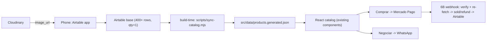

# Acervo do Marvete — In-Repo Build (sale-catalog-v2)

## Discovery

### Original Request
- "Analyze and proceed with our current PLAN [docs/PLAN-SUMMARY.md], review our codemap if necessary."

### Interview Summary (resolved 2026-10-11, from PLAN-SUMMARY §8 + business-plan §Decisions)
- **Brand:** Acervo do Marvete (retire "ASHBY & VANE").
- **Estate legality:** settled — clear to sell.
- **Checkout depth:** 6A first (per-item Mercado Pago payment links on a 20–30 item subset); 6B webhook after demand proven.
- **Shipping:** both — nationwide (Correios / Melhor Envio) + local pickup.
- **Inventory source of truth:** Airtable `Catalog` base. Never edit product data in code again.
- **Images:** Cloudinary (Airtable free tier caps attachments at 1 GB/base).
- **Hosting:** Cloudflare Pages; domain: Registro.br `.com.br`.
- **Execution location (PLAN-SUMMARY §10):** code lives in this dir (`67.18-Sale-Catalog-Site`); the referenced Hive feature in `65-Research` does not exist. Recommendation: `git init` here, then execute directly in this directory.
- **Operator tasks:** Airtable base creation, Cloudinary account, Mercado Pago links, domain purchase require human accounts — flagged per task.

### Research Findings (verified against live files)
- `package.json:2` — name is `ashby-and-vane` (stale). Scripts: `dev`, `build`, `preview` only.
- `index.html:6` — `<title>ASHBY & VANE …` (stale).
- `src/data/products.js:45-394` — `products` array, ~29 items. Schema: `{id,title,maker,category,price,condition,art,image,imageAlt,note,featured}`. **No `status`, `mp_link`, `order_ref`.**
- `src/data/products.js:397` — `byCategory(cat)` helper. `:34` `CATEGORIES`, `:399` `journalPosts`, `:432` `NAV_LINKS`, `:434` `SUB_NAV`.
- `src/App.jsx:13,22-29` — imports `products`/`byCategory` and renders `CategoryRail` per category + `<Catalog/>`.
- `src/components/Catalog.jsx:21-38` — search + filter + sort already exist (curated/price/oldest). **No pagination** → Task 8 gap.
- `src/components/ProductCard.jsx:68` — `add(product.id)` calls `useCart().add`. **No checkout button.**
- `src/components/ProductMedia.jsx:21-38` — renders `product.image` when present, else `<Plate>` glyph fallback. Good hook for Task 4.
- `src/context/CartContext.jsx:11-27` — cart API: `add(id)`, `setQty(id,qty)`, `remove(id)`, `clear()`, `count`, `subtotal`, `open`, `setOpen`, `pulse`.
- `src/lib/format.js:1` — `brl(n)` BRL formatter; `gbp` alias retained.
- `.gitignore`, `.env.example`, `README.md` — **created in Task 1 (this session)**.
- `docs/business-plan.md` — full business context; `docs/PLAN-SUMMARY.md` — execution brief (reviewed OKAY).
- Codemaps (`src/components/codemap.md`) reference **non-existent** components (`Header/ProductList/Cart/SearchBar/CategoryFilter`) — codemap is stale; do not trust for file names.

---

## Non-Goals (what we are NOT building)
- No custom auth/accounts for buyers — checkout is Mercado Pago's hosted flow.
- No admin UI inside the React app — Airtable's phone app is the admin (Task 5).
- No database of our own — Airtable is the store (no Postgres/Supabase).
- No server framework — the only server code is the Cloudflare Pages Function for the Task 6B webhook.
- No 6B webhook until 6A demand is proven.
- No multi-currency / international shipping.
- No editing product data in code after Task 3 (products become generated).
- Task 9 (social/SEO) is explicitly deferred until there is traffic.

---

## Design Summary

The storefront already works; the two real bottlenecks are **listing throughput** (400+ unique items, from a phone, ~60s each) and **trust + secure checkout**. Every task serves those two.

Admin moves to **Airtable**; images to **Cloudinary**; the build **syncs** Airtable → a generated JSON the existing React components already consume. Sold items are filtered at build time. Checkout starts as **Mercado Pago per-item payment links** (6A), graduating to **Checkout Pro + a verified webhook** (6B) that re-fetches the payment, marks the item sold, and refunds any duplicate sale on a unique item.

**Fail-loud sync:** creds absent → exit 0 + warn, use sample; creds present but API fails or 0 items → exit 1 (fail the build).

---

## Amendment Log (Hygienic REJECT fixes, 2026-10-11)

- **Task 3 — fail-loud masking:** `prebuild` no longer chains `sync || ensure-catalog` (the `||` let a failed sync fall back to the sample and build "successfully"). `prebuild` now runs `sync-catalog.mjs` alone → a sync failure fails the build. `ensure-catalog.mjs` is `predev`-only and never masks a sync failure.
- **Task 3 — loader ambiguity:** one concrete approach: static `import generated from './products.generated.json'`; the file is guaranteed by `prebuild`/`predev`; no runtime fallback, no dynamic-import branch.
- **Task 3 — field mapping:** full Airtable→app map stated (`image_url`→`image`, `image_alt`→`imageAlt`, `mp_link`→`mpLink`, `order_ref`→`orderRef`, `status`→`status`, `created`→`added`).
- **Task 6 — `mp_link`/`mpLink`:** mapping lives in Task 3; Task 6 only consumes `product.mpLink` (camelCase).
- **Task 6B — webhook:** exact manifest `id:<data.id>;request-id:<x-request-id>;ts:<ts>;`, HMAC-SHA256 hex, constant-time compare, 401 on mismatch, ~300s tolerance, lower-cased `data.id`, WebCrypto on Workers (no Node SDK), ack-fast + dedupe, decimal money units, reconciliation backstop.
- **Task 8 — dead `oldest` sort:** `Catalog.jsx:14,36` sorts on `p.era` which no product has (verified `grep -c "era:"` → 0). Now sorts by sync-provided `added`; `eraYear` helper deleted.
- **Task 2 — verify:** ESM fix (`require()` → dynamic `import()`).

---

## Tasks

### 1. Initialize repo & hygiene

**Depends on**: none

**Status**: DONE (this session) — committed as `bc44a79`.

**Files:**
- Create: `.gitignore`, `.env.example`, `README.md`
- Modify: `package.json` (scripts documented in README; `sync` script added in Task 3)

**What to do:**
- `git init -b main` in this directory (was not a repo — the §10 blocker).
- `.gitignore`: `node_modules/`, `dist/`, `.env*` (except `.env.example`), `src/data/products.generated.json`, editor/OS cruft.
- `.env.example`: `AIRTABLE_TOKEN`, `AIRTABLE_BASE_ID`, `AIRTABLE_TABLE`, `CLOUDINARY_CLOUD_NAME`, `CLOUDINARY_UPLOAD_PRESET`, `MP_ACCESS_TOKEN`, `MP_WEBHOOK_SECRET`. No `VITE_` prefix on secrets.
- `README.md`: quick start, scripts, architecture diagram, ≤60s listing SOP, security rules, oversell/refund policy, fail-loud sync policy.
- Initial commit bringing the existing storefront under version control.

**Must NOT do:**
- Do not commit `node_modules/`, `dist/`, or a real `.env`.
- Do not rename the brand yet (see Task 10).
- Do not add a `sync` npm script that points at a not-yet-existing file here (added in Task 3).

**References:**
- `docs/PLAN-SUMMARY.md:117-121` — why git init first.
- `package.json:5-9` — existing scripts.

**Verify:**
- [x] `git rev-parse --is-inside-work-tree` → `true`
- [x] `git log --oneline -1` → `bc44a79 chore: initialize repo with Vite+React catalog`
- [x] `git status --short | grep -E "node_modules|dist/"` → no output (ignored)

---

### 2. Airtable schema + seed export

**Depends on**: 1

**Files:**
- Create: `scripts/export-seed.mjs`, `seed-sample.json`
- Create (docs): `docs/airtable-schema.md`

**What to do:**
- **OPERATOR:** create the Airtable base and the `Catalog` table with 14 fields (`id,title,maker,category,price,condition,image_url,image_alt,art,note,featured,status,mp_link,order_ref`); `status` single-select `available|reserved|sold`; every row qty=1. **No attachment field.**
- Write `scripts/export-seed.mjs`: read `src/data/products.js`, map code schema → Airtable field names (`image`→`image_url`, `imageAlt`→`image_alt`), default `status='available'`, emit `seed-sample.json`.
  - Mapping: `{id,title,maker,category,price,condition,art,note,featured}` pass-through; `image_url = image ?? ''`; `image_alt = imageAlt ?? ''`; `mp_link=''`; `order_ref=''`.
- **OPERATOR:** import `seed-sample.json` into Airtable (CSV import) to bootstrap the base.
- Note: Airtable's automatic **`Created time`** field is always present and is *not* one of the 14 editable fields. The sync (Task 3) reads it as `added`, which backs the `oldest` sort (Task 8). No manual action needed.
- `docs/airtable-schema.md`: field table (type, notes, which are required), plus the category single-select values matching `src/data/products.js:34-43`.

**Must NOT do:**
- Do not add an Airtable attachment field (1 GB cap).
- Do not create per-item qty > 1 (every item is unique).

**References:**
- `docs/PLAN-SUMMARY.md:52-71` — 14-field data model.
- `src/data/products.js:34-43` — canonical category list.
- `src/data/products.js:114-135` — example product shape.

**Verify:**
- [ ] `node scripts/export-seed.mjs` → writes `seed-sample.json`; item count matches `products.length`.
- [ ] `node --input-type=module -e "import fs from 'node:fs'; const p = await import('./src/data/products.js'); const s = JSON.parse(fs.readFileSync('./seed-sample.json','utf8')); console.log(s.length, p.products.length)"` → equal numbers. (Note: `products.js` is ESM — plain `require()` fails; use dynamic `import()`.)
- [ ] `docs/airtable-schema.md` lists all 14 fields.
- [ ] OPERATOR: Airtable base shows the seeded rows with `status=available`.

---

### 3. Data sync layer

**Depends on**: 2

**Files:**
- Create: `scripts/sync-catalog.mjs`
- Create: `scripts/ensure-catalog.mjs`
- Create: `src/data/products.sample.json` (small committed fallback)
- Modify: `src/data/products.js` → re-point to generated data (keep `CATEGORIES`, helpers, `journalPosts`, `NAV_LINKS`, `SUB_NAV`)
- Modify: `src/context/CartContext.jsx:2` (import source)
- Modify: `src/components/Catalog.jsx:2` (import source)
- Modify: `src/App.jsx:13` (import source)
- Modify: `package.json` (add `"sync"`, `"prebuild"`, `"predev"` scripts)

**What to do:**
- `scripts/sync-catalog.mjs` — the **only** producer of `src/data/products.generated.json`:
  - Read `AIRTABLE_TOKEN`/`AIRTABLE_BASE_ID`/`AIRTABLE_TABLE`; paginate via `offset`; `filterByFormula` excludes `status='sold'`.
  - Field map (Airtable → app): `image_url`→`image`, `image_alt`→`imageAlt`, `mp_link`→`mpLink`, `order_ref`→`orderRef`, `status`→`status`, `created` (Airtable automatic `Created time`)→`added`. All other fields pass through unchanged.
  - Deterministic output: sort by `id` before writing so git diffs are stable.
  - **Fail-loud policy (no masking):**
    - Creds **absent** → if `products.generated.json` is missing, copy `products.sample.json` → it; log a warning; exit `0`.
    - Creds **present** but (a) HTTP/API error, or (b) `NODE_ENV=production` and 0 items → log error; exit `1` (**the build must fail**; never fall back to the sample).
- `scripts/ensure-catalog.mjs`: copies `products.sample.json` → `products.generated.json` **only if the target is missing**. Used by `predev` only (local dev without creds). It never overwrites a real synced file and never masks a sync failure.
- `src/data/products.sample.json`: committed, small (~6-item) valid array for creds-less local dev.
- `src/data/products.js`: a single static import — `import generated from './products.generated.json'` — exported as `products`; keep all existing named exports (`CATEGORIES`, `byCategory`, `journalPosts`, `NAV_LINKS`, `SUB_NAV`). The file is guaranteed to exist because `prebuild`/`predev` always run the sync/ensure step first; there is **no** runtime fallback and **no** dynamic-import branch (this removes the ambiguity).
- `package.json`:
  - `"sync": "node scripts/sync-catalog.mjs"`
  - `"prebuild": "node scripts/sync-catalog.mjs"`  ← **no `||` chaining**; a sync failure fails the build, exactly as the fail-loud policy requires.
  - `"predev": "node scripts/ensure-catalog.mjs"`

**Must NOT do:**
- Do not delete `CATEGORIES`, `byCategory`, `journalPosts`, `NAV_LINKS`, `SUB_NAV` from `products.js`.
- Do not silently fall back to the sample when creds are present (must exit 1).
- Do not include `sold` items in the generated output.

**References:**
- `docs/PLAN-SUMMARY.md:101-103` — fail-loud policy.
- `docs/PLAN-SUMMARY.md:36` — sold items filtered at build time.
- `src/App.jsx:13`, `src/components/Catalog.jsx:2`, `src/context/CartContext.jsx:2` — import sites to re-point.
- `src/data/products.js:397,399,432,434` — exports to preserve.

**Verify:**
- [ ] No creds: `node scripts/sync-catalog.mjs; echo $?` → `0` with a warning; `products.sample.json` used.
- [ ] Bad creds (set `AIRTABLE_TOKEN=x`): `node scripts/sync-catalog.mjs; echo $?` → `1`.
- [ ] Good creds: `npm run sync` writes `products.generated.json` with only `available`/`reserved` items.
- [ ] `npm run build` succeeds with the generated file present.
- [ ] `git status` shows `products.generated.json` ignored.

---

### 4. Image pipeline (Cloudinary)

**Depends on**: 2

**Files:**
- Create: `src/lib/cloudinary.js`
- Modify: `src/components/ProductMedia.jsx` (use the helper; add `srcset`/width hints; WebP/format auto)
- Modify: `src/components/ProductCard.jsx` (pass a sized URL/ratio if needed)
- Create (docs): `docs/image-pipeline.md`

**What to do:**
- **OPERATOR:** create a Cloudinary account; create a **restricted/signed** upload preset; upload existing `public/photos/*` and put delivery URLs into Airtable `image_url`.
- `src/lib/cloudinary.js`: `cldUrl(url, { w, h, crop='fill', quality='auto', format='auto' })` — inject transformation params **only when** `typeof url === 'string' && url.includes('res.cloudinary.com') && url.includes('/image/upload/')`; otherwise return `url` unchanged (local `/photos/...`, empty, or `undefined`). Insertion point: immediately after `/image/upload/` → `…/image/upload/<params>/<publicId>`.
- `ProductMedia.jsx`: when `product.image` is a Cloudinary URL, render `src` + `srcSet` (e.g. 400/800/1200) with `sizes`; keep `loading="lazy"`, `decoding="async"`. Keep the `<Plate>` glyph fallback untouched.
- `docs/image-pipeline.md`: preset settings, naming, and the rule **never an open unsigned preset**.

**Must NOT do:**
- Do not use an open unsigned upload preset.
- Do not put the Cloudinary API secret in client code (only the public cloud name).
- Do not remove the glyph fallback path.

**References:**
- `docs/PLAN-SUMMARY.md:50,98` — external images + restricted preset.
- `src/components/ProductMedia.jsx:21-38` — image render path.
- `src/components/ProductCard.jsx:26` — `ratio="aspect-[4/5]"` usage site.

**Verify:**
- [ ] `node -e "import('./src/lib/cloudinary.js').then(m=>console.log(m.cldUrl('https://res.cloudinary.com/demo/image/upload/sample.jpg',{w:400})))"` → URL contains `w_400` and `f_auto`.
- [ ] `npm run dev`, open catalog with a Cloudinary-backed item → image loads; non-Cloudinary item still renders.
- [ ] `docs/image-pipeline.md` documents the restricted preset.
- [ ] OPERATOR: at least the launch-subset items have real Cloudinary `image_url` in Airtable.

---

### 5. Phone-first admin SOP

**Depends on**: 2, 4

**Files:**
- Create: `docs/listing-sop.md`

**What to do:**
- Write a ≤60s/item checklist (photograph → Cloudinary upload → Airtable row → 5 fields → publish) that mirrors `README.md` but with screenshots-in-words, field-by-field guidance, and common mistakes.
- Include a "weekly inventory sweep" routine (re-price slow movers, mark sold, refresh photos).
- Note the optional restricted-upload form is **deferred** (not built now).

**Must NOT do:**
- Do not build an in-app admin form (Airtable app is the admin).

**References:**
- `docs/PLAN-SUMMARY.md:81` — Task 5 scope.
- `docs/business-plan.md:166-169` — recurring processes.

**Verify:**
- [ ] `docs/listing-sop.md` exists; a reader can list an item end-to-end without touching code.
- [ ] Checklist enumerates the 5 required Airtable fields per item.

---

### 6. Checkout — Mercado Pago

**Depends on**: 3

**Files:**
- Consume: `product.mpLink` (the `mp_link`→`mpLink` mapping is already produced by Task 3's sync — **no sync change here**)
- Modify: `src/components/ProductCard.jsx` (add "Comprar" button → `mp_link` when present)
- Create: `src/lib/whatsapp.js` (`waLink({ phone, text })`)
- Modify: `src/components/CartDrawer.jsx` (checkout/negotiate actions)
- **6B:** Create: `functions/api/mp-webhook.js` (Cloudflare Pages Function)
- Create (docs): `docs/checkout.md`

**6A (do now):**
- **OPERATOR:** create per-item Mercado Pago payment links for a 20–30 item launch subset; paste each into Airtable field `mp_link`.
- Mapping is already wired in Task 3: Airtable `mp_link` → app `mpLink`. `ProductCard` reads `product.mpLink` (**camelCase**). This task only *consumes* it.
- `ProductCard.jsx`: when `product.mpLink` is a non-empty string, render a primary **Comprar** `<a>` to it (`target="_blank" rel="noopener noreferrer"`); otherwise keep **Adicionar** (cart). Always render a **Negociar** WhatsApp button.
- `whatsapp.js`: `waLink({ phone, text })` → `https://wa.me/<phone>?text=<encodeURIComponent(text)>`; text = `"Tenho interesse em: <title> (<share URL>)"`.

**6B (after demand proven — build only when operator says go):**
- `functions/api/mp-webhook.js` (Cloudflare Pages Function — runs on the Workers runtime, so use **WebCrypto `crypto.subtle`**, NOT the Node `mercadopago` SDK helper or `node:crypto`):
  - **Signature check (reject `401` on any failure):** read `x-signature` (`ts=…;v1=…`), `x-request-id`, and `data.id` from the query string (`?data.id=`) or body. Build the manifest **exactly**: `id:<data.id>;request-id:<x-request-id>;ts:<ts>;` with `data.id` **lower-cased**. Compute `HMAC-SHA256(MP_WEBHOOK_SECRET, manifest)` → hex and compare in **constant time** to `v1`. Also reject if `|now − ts|` exceeds the tolerance (~300s).
  - **Ack fast:** return `200` immediately, then do the work out of band, so MP retries don't duplicate fulfillment.
  - **Never trust the body:** re-fetch `GET /v1/payments/{id}` with `Authorization: Bearer <MP_ACCESS_TOKEN>` and act on the fetched `status` / `external_reference`.
  - **Dedupe:** record processed event ids (resource id + `action`) and skip repeats — MP delivery is at-least-once.
  - **Fulfill:** first `approved` payment → PATCH the Airtable row `status=sold` + `order_ref`.
  - **Oversell:** a **second** `approved` payment for an already-`sold` item → `POST /v1/payments/{id}/refunds` (full refund).
  - **Money units:** MP amounts are **decimal currency** (e.g. `149.90`), not cents — do not divide by 100.
  - **Reconciliation backstop:** a scheduled `GET /v1/payments/search?external_reference=<order>` for orders stuck `pending` reconciles local state **to** MP (never the reverse).

**Must NOT do:**
- Do not trust the notification body — always re-fetch.
- Do not expose `MP_ACCESS_TOKEN` to the client.
- Do not build 6B until 6A is validated (decided).
- Do not delete Airtable rows on refund — mark state only.

**References:**
- `docs/PLAN-SUMMARY.md:82` — 6A then 6B.
- `docs/PLAN-SUMMARY.md:90-94` — oversell & refund policy.
- `docs/PLAN-SUMMARY.md:96-99` — webhook HMAC verification.
- `src/components/ProductCard.jsx:68-74` — current button area.
- `src/components/CartDrawer.jsx` — drawer from which checkout is offered.

**Verify:**
- [ ] 6A: an item with `mpLink` shows a working Comprar link; item without it falls back to Adicionar/Negociar.
- [ ] 6A: Negociar opens `wa.me` with the item title prefilled.
- [ ] 6B (when built): a replayed webhook with a tampered signature → HTTP 401.
- [ ] 6B: a duplicate paid sale on a sold item triggers a full refund (asserted against MP sandbox).

---

### 7. Hosting, domain & DNS

**Depends on**: 3

**Files:**
- Create: `wrangler.toml` (or document Pages dashboard settings)
- Create (docs): `docs/deploy.md`

**What to do:**
- **OPERATOR:** connect the repo to **Cloudflare Pages**; build command `npm run build`, output `dist/`; set build-time env vars (`AIRTABLE_*`, `MP_*`, `CLOUDINARY_*`) in Pages settings.
- **OPERATOR:** register `<name>.com.br` at **Registro.br**; point DNS to Cloudflare Pages; ensure HTTPS.
- `docs/deploy.md`: exact steps, env var list, rollback.

**Must NOT do:**
- Do not put secrets in `wrangler.toml` committed to git (use Pages env / `wrangler secret`).

**References:**
- `docs/PLAN-SUMMARY.md:83` — Task 7 scope.
- `docs/PLAN-SUMMARY.md:104` — domain R$40/yr.
- `.env.example` — env vars to mirror in Pages.

**Verify:**
- [ ] `docs/deploy.md` lists build command, output dir, and every required env var.
- [ ] OPERATOR: a Pages preview URL serves the site; `/` returns 200 and the catalog renders.
- [ ] OPERATOR: production domain serves over HTTPS.

---

### 8. Catalog scale UX (400+ items)

**Depends on**: 3

**Files:**
- Modify: `src/components/Catalog.jsx` (pagination + result virtualization/limits)
- Create: `src/lib/paginate.js`
- Create (test): `src/lib/paginate.test.js`

**What to do:**
- Search, filter, and sort **already exist** (`Catalog.jsx:21-38`) — do not rebuild them.
- Add **pagination** (page size ~24) with prev/next + page indicator; reset to page 1 when query/category/sort changes.
- `src/lib/paginate.js`: pure `paginate(items, page, pageSize)` → `{ items, totalPages, page }`.
- Keep the result count line in sync; when paginated, show "X–Y of N".
- Write a small unit test for `paginate` (red→green).
- **Fix the dead `oldest` sort:** `Catalog.jsx:14,36` compares `p.era`, but no product carries an `era` field (`grep -c "era:" src/data/products.js` → `0`), so this option currently **no-ops**. Sort by the sync-provided `added` timestamp (Task 3) instead: `list = [...list].sort((a, b) => new Date(a.added) - new Date(b.added))`, and delete the now-unused `eraYear` helper (`Catalog.jsx:14`).

**Must NOT do:**
- Do not add a server search — client-side only over the generated JSON.
- Do not change the **set** of sort options (`curated/price-asc/price-desc/oldest`); `oldest` keeps its label but gains a real backing field.

**References:**
- `src/components/Catalog.jsx:21-38` — existing filter/sort.
- `src/components/Catalog.jsx:115-120` — results-meta line to update.
- `docs/PLAN-SUMMARY.md:84` — search, filter, sort, pagination for 400+.

**Verify:**
- [ ] `node --test src/lib/paginate.test.js` → passes (page bounds, last partial page, invalid page clamps to 1).
- [ ] With 400+ generated items, the catalog renders 24 per page and paging works without jank.
- [ ] Changing category or search resets to page 1.
- [ ] Selecting "Mais antigos primeiro" reorders by `added` (no longer a silent no-op).

---

### 9. Social sharing & SEO

**Depends on**: 6, 8

**Status**: DEFERRED until there is traffic (decided). Plan only; do not execute yet.

**What to do (when unblocked):**
- Per-item OG images (Cloudinary `og_` transformation), shareable item URLs, `og:`/`twitter:` meta per item, sitemap.

**Must NOT do:**
- Do not start before traffic proves the funnel.

**References:**
- `docs/PLAN-SUMMARY.md:85` — deferred.

**Verify:**
- [ ] (deferred) N/A until unblocked.

---

### 10. Launch polish & trust

**Depends on**: 6, 7, 8

**Files:**
- Modify: `index.html` (title/description → Acervo do Marvete)
- Modify: `package.json:2` (name)
- Modify: `src/data/products.js` header comments + any "ASHBY & VANE" strings
- Modify: `src/components/Footer.jsx`, `src/components/Announcement.jsx`, `src/components/Hero.jsx`, `src/components/Nav.jsx` (brand copy)
- Create (docs): `docs/condition-guide.md`, `docs/shipping-returns.md`, `docs/faq.md`

**What to do:**
- Retire "ASHBY & VANE" everywhere: `grep -rI "ASHBY\|Ashby\|ashby-and-vane"` and replace with Acervo do Marvete.
- Real brand copy (hero, footer, announcement) reflecting a single-owner curated collection.
- Condition guide (Novo/Seminovo/Usado definitions), shipping/returns policy (nationwide + local pickup; no-return for used items with clear disclosure), FAQ.
- Mobile QA pass (phone-first): listing flow readability, tap targets, cart drawer.

**Must NOT do:**
- Do not change product pricing or inventory data (that lives in Airtable).
- Do not touch checkout webhook logic here.

**References:**
- `index.html:6` — stale title.
- `package.json:2` — stale name.
- `docs/business-plan.md:39` — brand note.
- `docs/PLAN-SUMMARY.md:86` — Task 10 scope.

**Verify:**
- [ ] `grep -rI "ASHBY\|Ashby\|ashby-and-vane" src index.html package.json` → no matches.
- [ ] `docs/condition-guide.md`, `docs/shipping-returns.md`, `docs/faq.md` exist.
- [ ] `npm run build` succeeds; site renders correct brand on mobile viewport.
