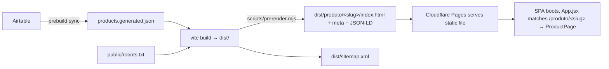

# catalog-growth — Per-product SEO pages, brand consistency & 30-day social calendar

## Discovery

### Original Request
- "Analyze the business's Facebook/Instagram pages and the storefront site, then produce market sizing and a strategy to bring more people to see/sell an inherited collection."
- After analysis, user selected: **"Fix site SEO blockers, Resolve brand name, and Build the 30-day content calendar."**

### Interview Summary
- **Brand name:** standardize everything on **"Acervo do Marvete"** (already the site + business plan). IG/FB display names ("V de Vingança") will be renamed **by the operator from the apps** — we cannot change them via code, so we ship rename instructions.
- **SEO scope:** **Full** — build-time prerendered per-product pages with per-item OG image + JSON-LD Product schema (not just site-level tags).
- Contact data confirmed from the public FB page: `+55 51 8500-0282`, `andressactrh@gmail.com`, Rio Grande do Sul.

### Research Findings
- `src/App.jsx:51,73-80` — SPA, single `/`; only `#/admin` and `/admin` are special-cased. **No product detail route exists.** Docs use hash routes (`#/faq`,`#/condicao`,`#/envio`).
- `src/components/Catalog.jsx` + `src/components/ProductCard.jsx` — cards render inline with "Adicionar / Comprar / Negociar" buttons; there is **no product page or modal**.
- `src/data/products.js:39` — `export const products = generated;` (from `products.generated.json`). Product shape: `id,title,maker,category,price,condition,art,image,imageAlt,note,featured,status,mpLink,orderRef,added`.
- `scripts/sync-catalog.mjs:42-52` — `mapRow` maps Airtable fields → product schema; **no `slug` field**; `rec.id` (Airtable recXXX) is dropped, a field named `id` passes through.
- `index.html:3-13` — has `title` + `meta description` only; **no OG/Twitter/canonical**.
- `public/` — **no `robots.txt`, no `sitemap.xml`**; only `_redirects` (`/admin → /index.html 200`) and `photos/`.
- `vite.config.js:5-10` — default `base: '/'` ⇒ built asset URLs are root-absolute, so copying `dist/index.html` into `dist/produto/<slug>/index.html` keeps assets working.
- `package.json:7-15` — `build: vite build`, `prebuild: sync`; `test: node --test`.
- `docs/deploy.md:92` — production domain is **`acervodomarvete.com.br`**; hosting = Cloudflare Pages serving `dist`.
- `src/components/Footer.jsx:7` — **placeholder contact** (`São Paulo, SP`, `+55 (11) 9999-0000`, generic email) that contradicts the real RS data → brand-consistency fix.
- Images: sample uses local `/photos/*.webp`; production Airtable `image_url` may be an absolute Cloudinary URL ⇒ OG image must be resolved to absolute.

---

## Non-Goals (What we're NOT building)
- No IG/FB API automation or auto-posting from this repo (operator posts manually).
- No paid-ads automation; the calendar is a manual checklist.
- No migration off Airtable, Cloudflare Pages, or Mercado Pago.
- No full site-wide i18n or redesign.
- Not renaming the git repo or the deployed Pages project.
- Not adding a client-side router library (route detection stays a small pathname check).
- **Not adding a `/* /index.html 200` SPA catch-all** to `_redirects` (see Ghost Diffs).

---

## Ghost Diffs (rejected alternatives)
- **Hash-routed product pages (`#/produto/x`)** — rejected: hash fragments are not indexable per-URL and OG crawlers ignore them.
- **Standalone static HTML per product (no React)** — rejected: duplicates the visual design, drifts from the app, high maintenance.
- **Adding `react-router`** — rejected as YAGNI for one route; a pathname check is enough.
- **Site-level OG tags only (minimal scope)** — rejected by the user in favor of full prerender.
- **Blanket SPA catch-all `/* /index.html 200`** — rejected: on Cloudflare Pages, prerendered product pages are real static files (`dist/produto/<slug>/index.html`) served directly. A catch-all rule could intercept those paths and serve the shell instead of the product's prerendered HTML. Static files + Pages' trailing-slash handling are the correct, safer mechanism.

---

## Design Summary

Add a real, shareable **`/produto/<slug>`** page for every catalog item, generated at build time, so links posted to Instagram/Facebook/WhatsApp render a rich preview (image + title + price) and Google can index each item. The React SPA renders the same page when a human opens it; a build step writes a per-product `index.html` with injected meta + JSON-LD and a `sitemap.xml`. Alongside: baseline OG/canonical on the shell `index.html`, a `robots.txt`, real brand contact in the footer, and a 30-day social content calendar.



> **Review follow-up (v2):** added slug-collision fail-fast (Task 1), robust image fallback + extra verify steps (Task 3), and a documented 404 behavior. The blanket catch-all was evaluated and rejected (Ghost Diffs). The v1 line-number criticism was checked against the files — the cited lines are accurate.

---

## Tasks

### 1. Slug + site-config plumbing (with collision guard)

**Depends on**: none

**Files:**
- Create: `src/lib/slug.js`
- Test: `src/lib/slug.test.js`
- Create: `src/lib/site.js`
- Modify: `scripts/sync-catalog.mjs`
- Modify: `.env.example`

**What to do**:
- Step 1: Write the failing test
  ```js
  // src/lib/slug.test.js
  import { test } from 'node:test';
  import assert from 'node:assert/strict';
  import { slugify, productSlug, assignSlugs } from './slug.js';

  test('slugify strips accents, lowercases, hyphenates', () => {
    assert.equal(slugify('Sandman — Edição Definitiva Vol. 1'), 'sandman-edicao-definitiva-vol-1');
    assert.equal(slugify('  Ação & Aventura!  '), 'acao-aventura');
  });
  test('productSlug prefers explicit slug, then id, then title', () => {
    assert.equal(productSlug({ slug: 'x-custom', id: 'foto-01', title: 'Z' }), 'x-custom');
    assert.equal(productSlug({ id: 'hq-002', title: 'Z' }), 'hq-002');
    assert.equal(productSlug({ title: 'Edição Especial' }), 'edicao-especial');
  });
  test('assignSlugs dedupes collisions with a numeric suffix', () => {
    const out = assignSlugs([{ title: 'Mesmo' }, { title: 'Mesmo' }]);
    assert.deepEqual(out.map((p) => p.slug), ['mesmo', 'mesmo-2']);
  });
  ```
- Step 2: Run test to verify it fails
  - Run: `node --test src/lib/slug.test.js`
  - Expected: FAIL — cannot find module `./slug.js`
- Step 3: Implement `src/lib/slug.js`
  ```js
  export function slugify(input) {
    return String(input ?? '')
      .normalize('NFD').replace(/[\u0300-\u036f]/g, '')
      .toLowerCase()
      .replace(/[^a-z0-9]+/g, '-')
      .replace(/^-+|-+$/g, '')
      .slice(0, 80);
  }
  export function productSlug(product) {
    return product?.slug || slugify(product?.id || product?.title);
  }
  // Assign unique slugs; on collision append -2, -3, …
  export function assignSlugs(items) {
    const seen = new Map();
    return items.map((p) => {
      const base = productSlug(p) || 'item';
      const n = seen.get(base) || 0;
      seen.set(base, n + 1);
      return { ...p, slug: n === 0 ? base : `${base}-${n + 1}` };
    });
  }
  ```
- Step 4: Create `src/lib/site.js`
  ```js
  export const SITE = {
    name: 'Acervo do Marvete',
    url: (import.meta.env?.VITE_SITE_URL || 'https://acervodomarvete.com.br').replace(/\/+$/, ''),
    whatsapp: '+555185000282',
    email: 'andressactrh@gmail.com',
    city: 'Rio Grande do Sul, BR',
    social: {
      instagram: 'https://instagram.com/acervodomarvete',
      facebook: 'https://facebook.com/acervodomarvete',
    },
  };
  ```
- Step 5: In `scripts/sync-catalog.mjs`, import `assignSlugs` from `../src/lib/slug.js`; replace the `sortCatalog(all)` write with `const withSlugs = assignSlugs(all);` then `sortCatalog(withSlugs)`.
- Step 6: Add to `.env.example` under the "Deploy Hook & Environment" block: `VITE_SITE_URL=https://acervodomarvete.com.br  # public site origin (used for canonical/OG)`.
- Step 7: Run `node --test src/lib/slug.test.js` → PASS; run `npm run sync` → items each have a unique `slug`.
- Step 8: Commit
  ```bash
  git add src/lib/slug.js src/lib/slug.test.js src/lib/site.js scripts/sync-catalog.mjs .env.example src/data/products.generated.json
  git commit -m "feat(seo): add product slug + site config"
  ```

**Must NOT do**:
- Do not change existing product field names or drop any field.
- Do not add a client router dependency.

**References**:
- `src/lib/slug.js` (new) — slug utilities.
- `scripts/sync-catalog.mjs:42-52` — `mapRow` (field mapping); `:102-103` — the `sortCatalog` write to patch.

**Verify**:
- [ ] `node --test src/lib/slug.test.js` → all pass
- [ ] `npm run sync` then `grep -c '"slug"' src/data/products.generated.json` → == item count
- [ ] `grep -c '"slug": ""' src/data/products.generated.json` → 0 (no empty slugs)
- [ ] `node -e "const d=require('./src/data/products.generated.json');const s=d.map(p=>p.slug);if(new Set(s).size!==s.length)process.exit(1);console.log('unique ok')"` → `unique ok`

---

### 2. Product detail route + view

**Depends on**: 1

**Files:**
- Create: `src/pages/ProductPage.jsx`
- Modify: `src/data/products.js`
- Modify: `src/App.jsx`

**What to do**:
- Step 1: In `src/data/products.js`, add a lookup:
  ```js
  import { productSlug } from '../lib/slug.js';
  export const getBySlug = (slug) => products.find((p) => productSlug(p) === slug);
  ```
- Step 2: Create `src/pages/ProductPage.jsx` — a self-contained view reusing existing pieces: `ProductMedia`, `brl`, `waLink`, `WHATSAPP_PHONE`, `useCart`, `SITE`. It must show: title, maker, category, condition badge, price, product image (with the same image fallback used by `meta.js`), the note, "Adicionar ao carrinho" / "Comprar" (if `mpLink`), "Negociar no WhatsApp", and a "← Voltar ao catálogo" link to `/`. If `getBySlug` returns nothing, render a "Produto não encontrado" block (accept 200 status — see Design note) with a link home.
- Step 3: In `src/App.jsx`, detect the path **before** the admin check:
  ```js
  const productMatch = window.location.pathname.match(/^\/produto\/([^/]+)\/?$/);
  ```
  When it matches, render `<ProductPage slug={decodeURIComponent(productMatch[1])} />` **inside `CartProvider`**, with `Nav` + `Footer` so navigation/cart work.
- Step 4: Run the dev server and open a product URL.
  - Run: `npm run dev &` then `curl -sI http://localhost:5173/produto/sandman-edicao-definitiva-vol-1/`
  - Expected: `200`
- Step 5: Commit
  ```bash
  git add src/pages/ProductPage.jsx src/data/products.js src/App.jsx
  git commit -m "feat(seo): render per-product page from /produto/<slug>"
  ```

**Must NOT do**:
- Do not alter the home page rendering or the existing `#/admin` behaviour.
- Do not change `ProductCard` behaviour (it stays as-is on the catalog).

**References**:
- `src/App.jsx:50-92` — top-level render branch to extend.
- `src/components/ProductCard.jsx:1-17,59-104` — patterns to reuse (condition styles, CTAs, WhatsApp link).

**Verify**:
- [ ] `npm run dev` then `curl -sI http://localhost:5173/produto/<real-slug>/` → `200`
- [ ] `curl -s http://localhost:5173/produto/<real-slug>/` contains `<div id="root"` (app shell present)
- [ ] `curl -sI http://localhost:5173/` → `200` (home still works)

---

### 3. Prerender per-product HTML + sitemap + robots

**Depends on**: 1, 2

**Files:**
- Create: `src/lib/meta.js`
- Test: `src/lib/meta.test.js`
- Create: `scripts/prerender.mjs`
- Modify: `package.json`
- Create: `public/robots.txt`

**What to do**:
- Step 1: Write failing tests for the pure meta builders
  ```js
  // src/lib/meta.test.js
  import { test } from 'node:test';
  import assert from 'node:assert/strict';
  import { esc, absoluteUrl, buildProductMeta, renderHeadTags, buildSitemap } from './meta.js';

  const site = 'https://acervodomarvete.com.br';
  const product = { slug: 'foto-01', title: 'Sandman "Edição" & Vol. 1', maker: 'Panini', category: 'Quadrinhos', price: 120, condition: 'Novo', image: '/photos/whatsapp-01.webp', note: 'Lacrado', status: 'available' };

  test('esc escapes html', () => { assert.equal(esc('a"b&<c>'), 'a&quot;b&amp;&lt;c&gt;'); });
  test('absoluteUrl prefixes relative paths', () => {
    assert.equal(absoluteUrl(site, '/x.jpg'), site + '/x.jpg');
    assert.equal(absoluteUrl(site, 'https://cdn/x.jpg'), 'https://cdn/x.jpg');
  });
  test('buildProductMeta builds canonical + og image + jsonld', () => {
    const m = buildProductMeta(product, site);
    assert.equal(m.canonical, site + '/produto/foto-01/');
    assert.equal(m.ogImage, site + '/photos/whatsapp-01.webp');
    assert.equal(m.jsonLd['@type'], 'Product');
    assert.equal(m.jsonLd.offers.priceCurrency, 'BRL');
  });
  test('buildProductMeta falls back on empty/whitespace image', () => {
    for (const image of ['', '   ', null, undefined]) {
      const m = buildProductMeta({ ...product, image }, site);
      assert.equal(m.ogImage, site + '/photos/whatsapp-01.webp');
    }
  });
  test('renderHeadTags emits og:title and canonical', () => {
    const html = renderHeadTags(buildProductMeta(product, site));
    assert.match(html, /og:title/);
    assert.match(html, /rel="canonical"/);
    assert.match(html, /"@type":"Product"/);
  });
  test('buildSitemap includes homepage and each product', () => {
    const xml = buildSitemap([product], site);
    assert.match(xml, new RegExp(site + '/produto/foto-01/'));
    assert.match(xml, /<urlset/);
  });
  ```
- Step 2: Run `node --test src/lib/meta.test.js` → FAIL (module missing).
- Step 3: Implement `src/lib/meta.js` (pure, node-safe, **no `import.meta`**):
  - `esc(s)`, `absoluteUrl(site, path)`.
  - `productImage(product, site)` → `const raw = typeof product.image === 'string' ? product.image.trim() : ''; return absoluteUrl(site, raw || '/photos/whatsapp-01.webp');` (handles `''`/null/whitespace).
  - `buildProductMeta(product, site)` → `{ title, description, canonical, ogImage, jsonLd }` where canonical = `${site}/produto/${slug}/`, ogImage = `productImage(...)`, description = `product.note || product.title`, and `jsonLd = { '@context':'https://schema.org','@type':'Product', name, image, description, brand:{'@type':'Brand',name:maker}, offers:{'@type':'Offer',price,priceCurrency:'BRL',availability: status==='available'?'https://schema.org/InStock':'https://schema.org/OutOfStock', url: canonical} }`.
  - `renderHeadTags(meta)` → `<title>…</title>` + canonical + `og:*` + `twitter:card` + `<script type="application/ld+json">…</script>`.
  - `buildSitemap(products, site)` → `<urlset>` with homepage + `/produto/<slug>/` entries.
- Step 4: Run `node --test src/lib/meta.test.js` → PASS.
- Step 5: Implement `scripts/prerender.mjs`:
  - Read `dist/index.html` and `src/data/products.generated.json`.
  - `const site = (process.env.VITE_SITE_URL || process.env.SITE_URL || 'https://acervodomarvete.com.br').replace(/\/+$/,'')`.
  - Assign slugs via `assignSlugs` and **fail fast** if any duplicate slug remains after dedupe is impossible (defensive): `if (new Set(slugs).size !== slugs.length) { console.error('duplicate slugs'); process.exit(1); }`.
  - For each product: write `dist/produto/<slug>/index.html` = shell with `renderHeadTags(...)` injected before `</head>` (strip the shell's own `<title>`).
  - Write `dist/sitemap.xml` = `buildSitemap(products, site)`.
  - Log `prerendered N product pages`.
- Step 6: Update `package.json` build script: `"build": "vite build && node scripts/prerender.mjs"`.
- Step 7: Create `public/robots.txt`:
  ```
  User-agent: *
  Allow: /
  Sitemap: https://acervodomarvete.com.br/sitemap.xml
  ```
  (Leave `public/_redirects` unchanged — static product files are served directly; see Ghost Diffs.)
- Step 8: Run `npm run build`.
  - Expected: build succeeds; `dist/produto/<slug>/index.html`, `dist/sitemap.xml`, `dist/robots.txt` exist.
- Step 9: Commit
  ```bash
  git add src/lib/meta.js src/lib/meta.test.js scripts/prerender.mjs package.json public/robots.txt
  git commit -m "feat(seo): prerender per-product HTML, sitemap, robots"
  ```

**Must NOT do**:
- Do not import `import.meta.env` inside `src/lib/meta.js` (must run under plain node).
- Do not change the asset paths produced by Vite (root-absolute is required for nested copies).
- Do not add a blanket `/* /index.html 200` to `_redirects`.
- Do not block the build on a missing sitemap/robots file.

**References**:
- `index.html:1-19` — shell to clone.
- `scripts/sync-catalog.mjs:19-26` — node script conventions.
- `docs/deploy.md:15-20` — build command/output dir assumptions.

**Verify**:
- [ ] `node --test src/lib/meta.test.js` → all pass
- [ ] `npm run build` exits 0
- [ ] `ls dist/produto/*/index.html | wc -l` → equals product count
- [ ] `grep -l 'og:title' dist/produto/*/index.html | wc -l` → equals product count
- [ ] `grep -l '"@type":"Product"' dist/produto/*/index.html | wc -l` → equals product count
- [ ] `grep -rl 'og:image" content=""' dist/produto/` → no matches (no empty OG image)
- [ ] `grep -c '/produto/' dist/sitemap.xml` → equals product count
- [ ] `cat dist/robots.txt` contains `Sitemap:`
- [ ] `npm run preview &` then `curl -sI http://localhost:4173/produto/<slug>/` → `200`

---

### 4. Baseline OG/Twitter/canonical on the shell

**Depends on**: none

**Files:**
- Modify: `index.html`

**What to do**:
- Step 1: Inside `<head>` (after the existing `description`), add:
  ```html
  <link rel="canonical" href="https://acervodomarvete.com.br/" />
  <meta property="og:type" content="website" />
  <meta property="og:site_name" content="Acervo do Marvete" />
  <meta property="og:locale" content="pt_BR" />
  <meta property="og:title" content="Acervo do Marvete — Quadrinhos, Action Figures &amp; Colecionáveis" />
  <meta property="og:description" content="Acervo de um único dono: quadrinhos, mangás, action figures, retro gaming e livros de coleção." />
  <meta property="og:url" content="https://acervodomarvete.com.br/" />
  <meta property="og:image" content="https://acervodomarvete.com.br/photos/whatsapp-01.webp" />
  <meta name="twitter:card" content="summary_large_image" />
  ```
- Step 2: Run `npm run build` and confirm the tags survive into `dist/index.html`.
- Step 3: Commit
  ```bash
  git add index.html
  git commit -m "feat(seo): add baseline OG/Twitter/canonical meta"
  ```

**Must NOT do**:
- Do not remove or alter the existing `lang`, `viewport`, `title`, or `description`.

**References**:
- `index.html:3-13` — current head.

**Verify**:
- [ ] `grep -c 'og:title' dist/index.html` → ≥ 1
- [ ] `grep -c 'rel="canonical"' dist/index.html` → 1
- [ ] `npm run build` exits 0

---

### 5. Brand-consistency fixes + rename runbook

**Depends on**: 1

**Files:**
- Modify: `src/components/Footer.jsx`
- Create: `docs/brand-and-social-setup.md`

**What to do**:
- Step 1: Replace the placeholder contact block in `src/components/Footer.jsx:7` with values sourced from `src/lib/site.js` (`SITE.city`, `SITE.whatsapp`, `SITE.email`) — real RS data already public on the FB page. Keep the same label/order so layout is unchanged.
- Step 2: Create `docs/brand-and-social-setup.md` with:
  - The decision: single brand = **Acervo do Marvete**.
  - Operator steps to rename IG + FB display names to "Acervo do Marvete" and set the profile-name field to `Acervo do Marvete | HQ, Mangá & Colecionáveis` (per `market-research-social-growth.md` §2.3).
  - Bio text to paste (store link = `https://acervodomarvete.com.br`).
  - A note that the "V de Vingança" story moves into the bio/content, not the display name.
- Step 3: Run `npm run build` to confirm no breakage.
- Step 4: Commit
  ```bash
  git add src/components/Footer.jsx docs/brand-and-social-setup.md
  git commit -m "fix(brand): real contact info + social rename runbook"
  ```

**Must NOT do**:
- Do not post the phone/email anywhere it isn't already public.
- Do not attempt IG/FB API changes.

**References**:
- `src/components/Footer.jsx:7` — placeholder contact.
- `docs/market-research-social-growth.md:62-64` — recommended profile name + bio.

**Verify**:
- [ ] `grep -n "São Paulo" src/components/Footer.jsx` → no matches
- [ ] `npm run build` exits 0
- [ ] `docs/brand-and-social-setup.md` exists

---

### 6. 30-day content calendar

**Depends on**: none

**Files:**
- Create: `docs/content-calendar-30d.md`

**What to do**:
- Step 1: Build a day-by-day table (D1–D30) from `docs/market-research-social-growth.md` §1.1 (6 formats), §2.1 (cadence), §2.2 (times), §6 (quick wins). Columns: `Dia · Formato · Peça/assunto · Canal (IG Reel/carrossel/Story · FB cross-post) · Horário · CTA · Comunidade`.
- Step 2: Encode the fixed rules at the top: 1 Reel/day feed + 2–5 Stories/day; post 18h–00h, seg–qui (quarta = pico); cross-post every Reel to FB; join/contribute in 5–8 communities in week 1.
- Step 3: Add a weekly target strip and the 30-day success metrics (150–400 followers, 5–15 sales, 1–2 Reels > 3K views) `[ESTIMATE]`.
- Step 4: Reference real asset needs (shelf-tour Reel, 9-post grid, WhatsApp broadcast list setup) with checkboxes.
- Step 5: Commit
  ```bash
  git add docs/content-calendar-30d.md
  git commit -m "docs: 30-day social content calendar"
  ```

**Must NOT do**:
- Do not invent specific product names — refer to "item do acervo real".

**References**:
- `docs/market-research-social-growth.md:18-29,49-67,156-172` — formats, cadence, quick wins.

**Verify**:
- [ ] `docs/content-calendar-30d.md` exists with exactly 30 data rows (`grep -c '^| D' docs/content-calendar-30d.md` → 30)
- [ ] Every row names a format from §1.1 and a channel

---

## Full-batch verification (after all tasks merged)
- [ ] `npm run build` exits 0
- [ ] `node --test` → all pass
- [ ] `dist/produto/*/index.html` count == product count; each contains `og:title` and `"@type":"Product"`
- [ ] `dist/sitemap.xml` + `dist/robots.txt` present
- [ ] `npm run preview &` then `curl -sI http://localhost:4173/produto/<slug>/` → `200` and body contains the product's OG title
