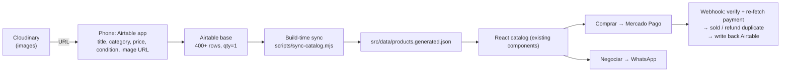

# Acervo do Marvete — Implementation Summary

> Consolidated brief for developing inside `67.18-Sale-Catalog-Site/`.
> Sources of truth: `docs/business-plan.md` (business) and the Hive `plan.md` (execution).
> Status: plan **OKAY** (reviewed), decisions resolved, **not yet built**.

---

## 1. What we're building (one line)

Turn the existing static catalog prototype into a **phone-first store** that liquidates a **400+ item** inherited collectibles collection (HQs, mangás, action figures, retro games, collector books) — branded **Acervo do Marvete**, sold via Instagram/Facebook.

## 2. The real problem (don't lose sight of this)

The storefront already exists and is good. The two actual bottlenecks are:

1. **Listing throughput** — turning 400+ physical, one-of-a-kind items into rows, from a phone, fast (~60s each).
2. **Trust + secure checkout** — buyers must trust condition/authenticity and be able to pay safely (Pix/cartão).

Every design choice below serves those two. If a task doesn't, it's out of scope.

## 3. Architecture (one-way data flow)

**Principle:** Airtable is the single source of truth. **Never edit product data in code again.** Sold items are filtered out at build time.

## 4. Stack & cost

| Layer | Tool | Cost |
|-------|------|------|
| Storefront | Vite + React 19 + Tailwind 4 (existing) | R$0 |
| Inventory / admin | Airtable (spreadsheet DB + phone app) | R$0 (free tier) |
| Images | Cloudinary (external CDN) | R$0 (free tier) |
| Hosting | Cloudflare Pages | R$0 |
| Checkout | Mercado Pago (payment links → Checkout Pro) | ~1–5% per sale |
| Domain | Registro.br `.com.br` | **R$40/yr** |
| Shipping labels | Correios / Melhor Envio | per label |

**Why external images:** Airtable free tier caps attachments at **1 GB/base** — 400+ photos overflow it. Cloudinary holds the images; Airtable stores only the URL.

## 5. Data model — Airtable table `Catalog` (14 fields)

| Field | Type | Notes |
|-------|------|-------|
| `id` | text | stable slug, e.g. `hq-002` |
| `title` | text | |
| `maker` | text | publisher/brand |
| `category` | single select | Quadrinhos, Marvel Comics, DC Comics, Action Figures, Retro Gaming, Livros de Coleção, Novidades |
| `price` | number (BRL) | |
| `condition` | single select | Novo, Seminovo, Usado |
| `image_url` | url | Cloudinary delivery URL |
| `image_alt` | text | |
| `art` | text | glyph fallback when no photo |
| `note` | long text | flaws, edition, completeness |
| `featured` | checkbox | |
| `status` | single select | available, reserved, sold |
| `mp_link` | url | Mercado Pago payment link |
| `order_ref` | text | payment/order id once sold |

**No attachment field.** Every item is **qty = 1**.

## 6. The 10 tasks (build order)

| # | Task | Depends on | One-liner |
|---|------|-----------|-----------|
| 1 | Initialize repo & hygiene | none | `git init` in site dir, `.gitignore`, `.env.example`, npm scripts, README SOP |
| 2 | Airtable schema + seed | 1 | Create `Catalog` table (14 fields); export existing products to `seed-sample.json` |
| 3 | Data sync layer | 2 | `sync-catalog.mjs` (offset pagination, `filterByFormula`) → generated JSON + sample fallback; repoint imports |
| 4 | Image pipeline | 2 | Cloudinary URL helper + optimized rendering; replace placeholders **in Airtable** |
| 5 | Phone-first admin SOP | 2, 4 | ≤60s listing checklist; Airtable app is the admin; optional restricted-upload form deferred |
| 6 | Checkout (Mercado Pago) | 3 | **6A** per-item payment links (20–30 item subset) → **6B** Checkout Pro + verified webhook |
| 7 | Hosting, domain & DNS | 3 | Cloudflare Pages (build-time env) + Registro.br `.com.br` + HTTPS |
| 8 | Catalog scale UX | 3 | Search, filter, sort, **pagination** for 400+ items |
| 9 | Social sharing & SEO | 6, 8 | **DEFERRED** until traffic — per-item OG images, shareable URLs |
| 10 | Launch polish & trust | 6, 7, 8 | Real brand copy, condition guide, shipping/returns, FAQ, mobile QA |

## 7. Cross-cutting policies (apply everywhere)

**Oversell & refund** (because every item is unique):
1. On any payment notification, **re-fetch** `GET /v1/payments/{id}` and trust the **fetched** status — never the notification body.
2. First paid item → `sold` + record `order_ref`.
3. A **second** paid sale on an already-sold item → **refund it in full** (`POST /v1/payments/{id}/refunds`).
4. Never delete rows.

**Security:**
- MP webhook: verify `x-signature`/`x-request-id` HMAC against `MP_WEBHOOK_SECRET`; reject on mismatch.
- Cloudinary: restricted preset or signed upload — **never an open unsigned preset**.
- No tokens/keys in client code (`MP_ACCESS_TOKEN`, `AIRTABLE_TOKEN` are server/build-time only).

**Fail-loud sync** (prevents shipping the sample as the real catalog):
- Sync exits **0 with a warning only when creds are ABSENT** (fall back to `products.sample.json`).
- Sync exits **1 (fails the build) when creds are present but the API fails, or a production sync returns 0 items.**

## 8. Decisions (resolved 2026-10-11)

1. **Brand:** **Acervo do Marvete** (retire "ASHBY & VANE").
2. **Estate legality:** **Settled — clear to sell.**
3. **Checkout depth:** **6A first** (payment links, 20–30 item subset); 6B after demand proven.
4. **Shipping:** **Both** — nationwide (Correios/Melhor Envio) + local pickup.

## 9. Open questions (non-blocking)

1. **Pricing source** — build a comp-lookup workflow (PriceCharting for games, sold-listing research for HQs)?
2. **Document language** — English now, or translate to Portuguese?

## 10. ⚠️ Critical execution note

- **Code lives here:** `67.18-Sale-Catalog-Site/` — currently **not a git repo**.
- **The Hive feature is registered in a different repo** (`65-Research`), so worktree delegation can't reach the code.
- **Resolution:** run **Task 1** (`git init` here) first, then either re-home the Hive feature into this repo or just execute the tasks directly in this directory (recommended for a solo project).

## 11. Where the docs live

- `docs/business-plan.md` — full business plan (market, model, financials, risks).
- `docs/PLAN-SUMMARY.md` — this file.
- Hive plan: `.hive/features/01_collections-catalog-v2/plan.md` (in the `65-Research` repo).
